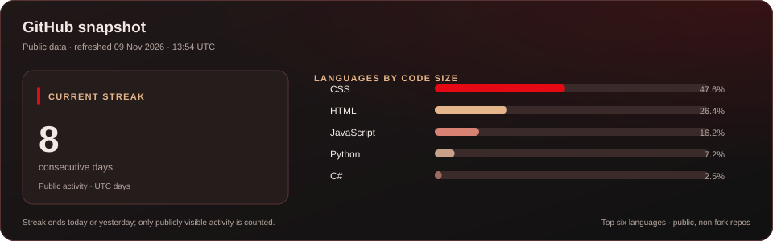

<!--
  Profile README for github.com/vivekanupindi
  Original profile layout using Vivek's own background, interests, and portfolio links.
-->

<div align="center">
  
</div>

<h2 align="center">Hi, I'm Vivek.</h2>

<p align="center">
  Computer Science Ph.D. student at the <strong>University of Maryland, Baltimore County (UMBC)</strong>.
  <br>
  I work across clinical NLP, healthcare-focused machine learning, predictive modeling, and the data systems that make analysis dependable.
</p>

<p align="center">
  <a href="https://vivekanupindi.github.io/">
    
  </a>
  <a href="mailto:vivekanupindi@umbc.edu">
    
  </a>
  <a href="https://www.linkedin.com/in/vivek-anupindi-6214831a0/">
    
  </a>
</p>

---

## The questions behind my work

I’m interested in practical questions at the intersection of AI, healthcare, and data:

| Area | Questions I explore |
|---|---|
| **Clinical language** | How can clinical narratives be represented and classified reliably, including across languages? |
| **Predictive healthcare** | How can temporal and contextual signals be studied to understand patterns and support careful forecasting? |
| **Data foundations** | What makes data pipelines traceable, well-integrated, and dependable enough for downstream analysis? |

## Work in progress

These are research and project directions I’m exploring—not claims of clinical deployment or validated medical tools.

### Clinical text → structured codes
Exploring multi-label ICD-10 classification from Spanish clinical narratives, including text preparation, label alignment, and comparisons between conventional machine-learning methods and multilingual transformer models.

### Health signals over time
An exploratory glucose time-series project focused on temporal modeling and contextual signals in short-term prediction.

### Reliable analytics workflows
Data engineering work around ETL, integration, validation, and cloud-based analytics—building a dependable foundation for analysis and machine-learning workflows.

<p align="center">
  <a href="https://vivekanupindi.github.io/#research">
    
  </a>
</p>

## How I approach a problem

Rather than starting with a model, I like to work through the full path from question to evidence:

| 01 · Frame | 02 · Prepare | 03 · Evaluate | 04 · Communicate |
|---|---|---|---|
| Define the question and intended use | Understand, integrate, and validate the data | Establish baselines and compare methods | Explain results, assumptions, and limitations |

## A little background

I’m pursuing a Ph.D. in Computer Science at UMBC. Before that, I completed an M.S. in Information Systems at Saint Louis University and a B.Tech in Computer Science at B. V. Raju Institute of Technology.

From **August 2023 to May 2025**, I worked as a Graduate Global Student with **Saint Louis University Information Technology Services (SLU ITS)**. My project work included identity and access management (IAM) and iPass-related integrations, with Mike Martin as an advisor.

## Tools I reach for

<p>
  <strong>Programming & analysis</strong><br>
  
  
  
  
  <br>
  <strong>Machine learning & analytics</strong><br>
  
  
  
  <br>
  <strong>Data platforms & cloud</strong><br>
  
  
  
  
  
  <br>
  <strong>Engineering workflow</strong><br>
  
  
  
  
</p>

## Try the research console

The live portfolio includes a small command-driven console. GitHub profile READMEs are static Markdown, so the actual text input runs on the portfolio—not inside this page.

<p align="center">
  <a href="https://vivekanupindi.github.io/#research-console">
    
  </a>
</p>

A few commands to try once it opens:

```text
help
whoami
cat current_focus.md
ls active_projects/
open research
open publications
open experience
open about
open contact
open fun-corner
clear
```

The console accepts these predefined portfolio commands; it is not an operating-system shell.

## Off the clock

Books, films, and stories are another way I stay curious. I keep a separate **Fun Corner** for reading lists and things I enjoy outside research.

<p align="center">
  <a href="https://vivekanupindi.github.io/blog.html">
    
  </a>
</p>

## GitHub snapshot

<p align="center">
  
</p>

This card shows a current streak based on consecutive UTC days with at least one publicly visible contribution, plus the language mix across public, non-fork, non-archived repositories. It refreshes daily through GitHub Actions. The card does not include private contributions or claim coding time.

---

<p align="center">
  <strong>Interested in thoughtful research, useful AI, and dependable data systems.</strong>
  <br>
  <a href="https://vivekanupindi.github.io/">Portfolio</a> ·
  <a href="https://www.linkedin.com/in/vivek-anupindi-6214831a0/">LinkedIn</a> ·
  <a href="mailto:vivekanupindi@umbc.edu">Email</a>
</p>
